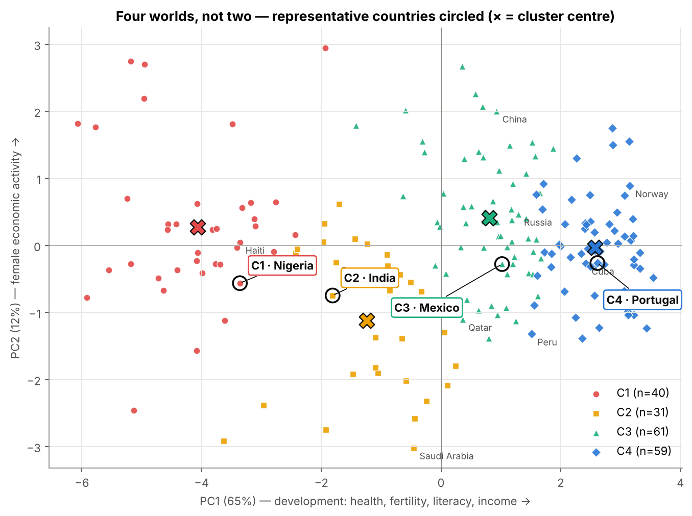
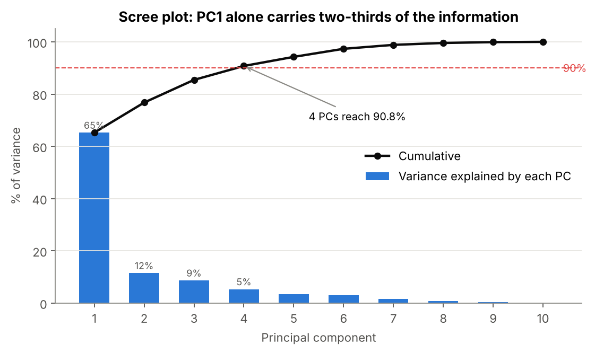
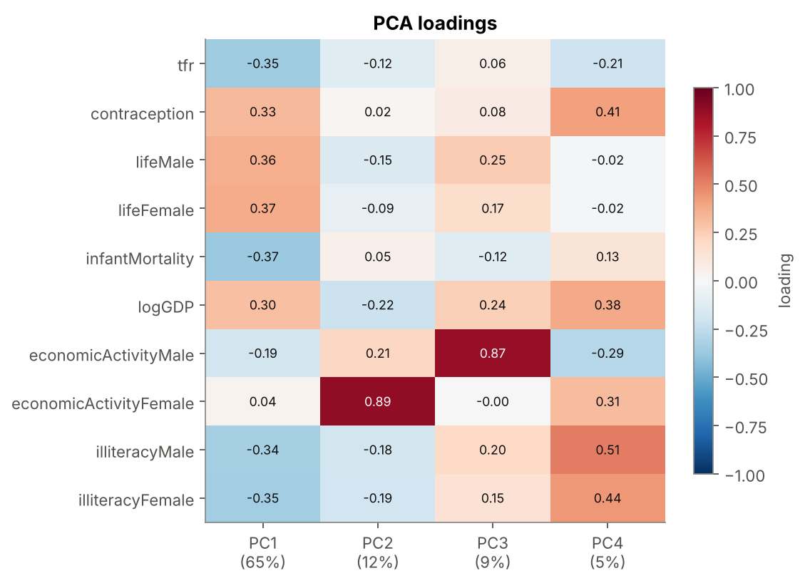
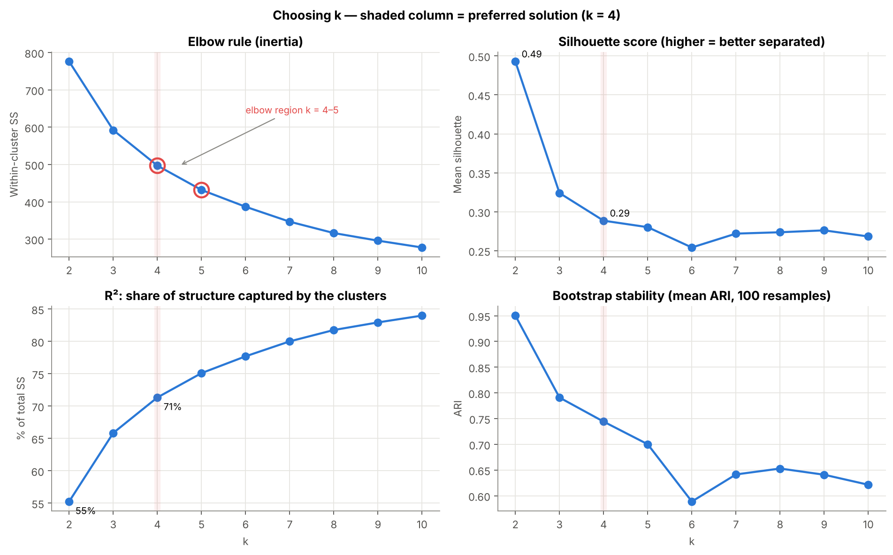
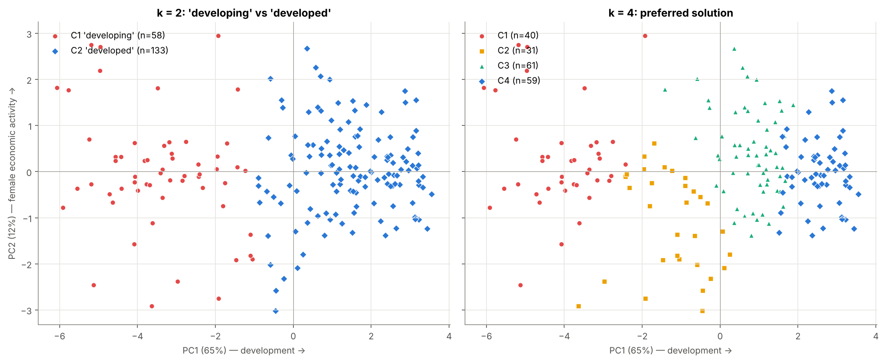
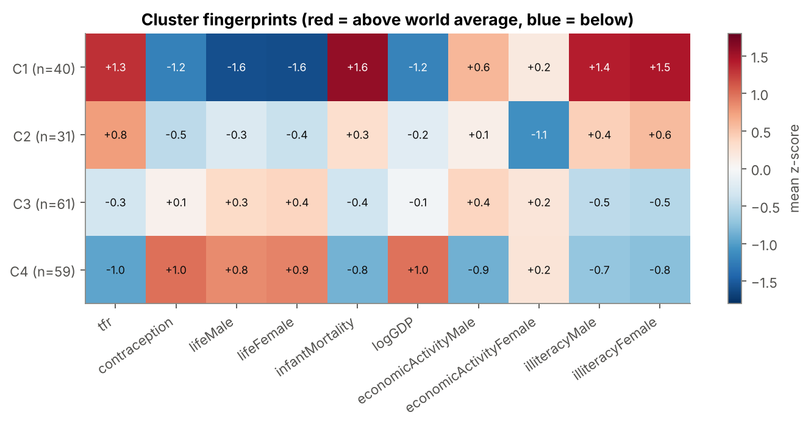

# How Many Worlds? PCA + K-Means on UN Country Data

**Research question:** Can the world be meaningfully divided into only two groups (developed vs. developing countries), or does the data suggest a more complex structure?

**Short answer:** No. A two-group split exists statistically, but it only separates a high-mortality "tail" from everyone else and puts Norway and Tajikistan in the same group. The data form a **continuum** along one development axis. Four clusters describe it much better, and they line up with the four income levels in Rosling's *Factfulness*.

## Repository contents

| File | What it is |
|---|---|
| `un_clusters_analysis.ipynb` | Complete analysis, executed, with all outputs and interpretation |
| `UN.csv` | Dataset ([source](https://raw.githubusercontent.com/manoelgadi/PSDMA/refs/heads/main/datasets/UN.csv)) |
| `figures/` | All charts produced by the notebook |
| `PRESENTATION.md` | 2–3 minute talk script |
| `requirements.txt` | Python packages |

**Reproduce:** `pip install -r requirements.txt`, then run all cells of the notebook (or `jupyter nbconvert --to notebook --execute un_clusters_analysis.ipynb`). All random steps use `random_state=42`.

> **Note on the data:** these UN indicators date from the late 1990s (it is the `UN` dataset from John Fox's *car* R package). Country positions describe that period, not today.

---

## Part 1: Data preparation

207 countries × 12 numeric indicators (plus `country` and `region`, used only to interpret results).

| # | Decision | Why |
|---|---|---|
| 1 | Drop `educationMale` / `educationFemale` | 63% missing. Imputing two-thirds of a column would invent most of it, and illiteracy carries similar information |
| 2 | Drop 16 countries missing more than 4 of the 10 remaining variables | Their profile would be mostly imputed. They are mainly micro-states (Andorra, Monaco, Tuvalu…) and disrupted territories (Somalia, Gaza Strip) |
| 3 | Fill remaining gaps (9.9% of cells) with the **regional median** | Neighbours are more similar than the world average, and the median is robust to skew. This is an improvement over the global-median fill used in Session 7 |
| 4 | `log10(GDPperCapita)`; keep all other outliers | GDP skewness falls from 2.0 to 0.0. Other extreme values (very high infant mortality, very low female labour participation in the Gulf) are real signal |
| 5 | Standardise all 10 variables (z-scores) | Without scaling, GDP's variance (≈ 80 million) is millions of times larger than fertility's (≈ 3). PCA on raw data is 100% GDP |

**Final matrix:** 191 countries × 10 variables.

## Part 2: PCA

| PC | % variance | Cumulative | Main variables |
|---|---|---|---|
| PC1 | 65.3% | 65.3% | life expectancy (+), infant mortality (−), fertility (−), contraception (+), illiteracy (−), log GDP (+), all with roughly equal weight |
| PC2 | 11.5% | 76.8% | female economic activity (+0.89) |
| PC3 | 8.7% | 85.4% | male economic activity (+0.87) |
| PC4 | 5.3% | **90.8%** | mixed residual (illiteracy, contraception, GDP; hard to interpret) |

**4 components explain 90%+ of the variance.** We cluster on these 4 PC scores.

## Part 3: How many clusters?

| k | R² (between-SS / total) | Silhouette | Bootstrap stability (ARI) |
|---|---|---|---|
| **2** | 55% | **0.49** | 0.95 |
| 3 | 66% | 0.32 | 0.79 |
| **4** | **71%** | 0.29 | 0.74 |
| 5 | 75% | 0.28 | 0.70 |
| 6 | 78% | 0.25 | 0.59 |

Robustness of the k = 4 solution: the ARI against our solution is 0.97 when clustering on all 10 variables instead of 4 PCs, 1.00 when outliers are capped at the 1st/99th percentile, and 0.87 when the 23 most-imputed countries are excluded. A Ward dendrogram (as in Session 7) also makes its first big cut at k = 2. Below that cut there is no clear second gap, which is what a continuum looks like. Its 4-group cut is also ordered by development level, but the boundaries fall in different places (ARI 0.47).

## Part 4: The four clusters

| Cluster | n | Representative | Median fertility | Median infant mortality | Median female life exp. | Median GDP/cap | ≈ $/day | Factfulness |
|---|---|---|---|---|---|---|---|---|
| C1 | 40 | **Nigeria** | 5.7 | 100 | 52 | $287 | 0.8 | Level 1 |
| C2 | 31 | **India** | 4.8 | 56 | 64 | $1,265 | 3.5 | Level 2 |
| C3 | 61 | **Mexico** | 2.8 | 25 | 73 | $1,860 | 5.1 | Level 3 |
| C4 | 59 | **Portugal** | 1.8 | 8 | 79 | $11,854 | 32.5 | Level 4 |

Representatives were chosen from the third of each cluster closest to its centroid: Nigeria is 12th of 40, India 2nd of 31, Mexico 18th of 61 and Portugal 5th of 59.

---

## Answers to the six questions

### 1. Can the world be meaningfully divided into only two clusters?
**No, not meaningfully.** K-Means with k = 2 does give the best-separated solution (silhouette 0.49), but it is not the "developed vs. developing" divide people imagine. It is a lopsided 58 vs. 133 split. Cluster 1 holds high-fertility, high-mortality countries, mostly sub-Saharan Africa plus Afghanistan, Bangladesh, Nepal and Haiti. Cluster 2, the so-called "developed" group, contains **everyone else**:
- GDP per capita ranges from $122 (Tajikistan) to $42,416 (Switzerland), a 350× range.
- Infant mortality ranges from 2 to 78 per 1,000.
- Fertility ranges from 1.2 to 7.2 children per woman.

Norway, Indonesia and Bolivia end up in the same group. The 2-cluster split separates a tail, not two worlds.

### 2. How many clusters does the data suggest?
- **Elbow rule:** inertia falls steeply up to k = 4–5 and flattens after. An objective elbow detector (maximum distance to the chord) gives k = 5, with k = 4 virtually tied (0.219 vs. 0.223).
- **Silhouette, Calinski-Harabasz, Davies-Bouldin:** all favour k = 2. These metrics reward the single largest gap in the data, which is the high-mortality tail. They have no competing peak, as expected for a continuum.
- **R²:** gains shrink after k = 4.
- **Bootstrap stability:** acceptable up to k = 4 (0.74) and keeps falling after (0.59 at k = 6).

Weighing all the evidence, we choose **k = 4**, with k = 3 as a reasonable alternative.

### 3. How much of the data structure do two clusters capture compared with four?
- **k = 2:** 55% of the total variance (between-cluster sum of squares / total, in the 4-PC space).
- **k = 4:** 71% of the total variance.

Four clusters capture 16 percentage points more of the structure, and every cluster has a distinct, interpretable profile.

### 4. Does the evidence support the *Factfulness* argument?
**Largely yes.** Three pieces of evidence support it:
- The PC1 histogram and the PCA map show a continuum with most countries in the middle, not two separated blobs.
- The four K-Means clusters are ordered along the development axis.
- The cluster medians (≈ $0.8, $3.5, $5, $32 per day) roughly follow Rosling's four income levels.

One honest caveat: because the data are a continuum, the exact boundaries between levels depend on the method (Ward places them differently). This also supports Rosling's point that there is no gap separating "us" and "them".

### 5. What does PCA tell us about the variables that differentiate countries?
- **One dimension dominates.** PC1 explains 65% of the variance, and life expectancy, infant mortality, fertility, contraception, literacy and income all load on it with similar weight. Development is a *bundle*: health, family size, education and income move together.
- **The second dimension is women's economic activity** (PC2, 12%). It separates countries at the *same* development level. For example, Saudi Arabia (7% female participation) and China (73%) differ sharply on PC2.
- Four PCs keep 91% of the information, so PCA reduces redundancy (male/female pairs, mortality vs. life expectancy) before clustering. It also provides the 2-D map used to visualise the clusters.

### 6. How would you describe the clusters, using one representative country each?

**C1, Nigeria: high fertility, high mortality, very low income (Level 1).**
- *Profile:* about 6 children per woman, 6% contraceptive use, infant mortality of 77 per 1,000, life expectancy of 51/54 years, and around half of women illiterate.
- *Members:* mostly sub-Saharan Africa.
- *Surprise:* Haiti, Afghanistan, Nepal, Bangladesh, Laos and Cambodia are here too. The cluster is defined by living conditions, not by continent.

**C2, India: early transition with low female participation (Level 2).**
- *Profile:* India is the 2nd most typical member. Fertility is about 3, infant mortality 72, female illiteracy 62% and female economic activity 34%.
- *Members:* Pakistan, Egypt, Morocco, Yemen, Kenya, Ghana.
- *What sets it apart:* this cluster has the lowest values on PC2 (women's labour participation and literacy).
- *Surprises:*
  - **Saudi Arabia and Oman** are here despite roughly 10× India's income. Their fertility and female indicators match C2.
  - **Botswana, Namibia and Zimbabwe** are here because AIDS pulled down their life expectancy despite middling incomes.

**C3, Mexico: the big middle (Level 3).**
- *Profile:* fertility 2.75, infant mortality 31, female life expectancy 75.5, GDP per capita $2,700.
- *Members:* the largest and most geographically diverse cluster. It includes Latin America, China, Indonesia and Thailand, and the former Soviet Union.
- *Surprises:*
  - **Qatar, Kuwait and the UAE** (incomes similar to Europe's) share this cluster with **China** ($582 GDP per capita).
  - **Russia** is here, not in C4, because of its 1990s mortality.

**C4, Portugal: low fertility, long lives, high income (Level 4).**
- *Profile:* fertility 1.5, infant mortality 8, female life expectancy 79.
- *Members:* Western and Central Europe, North America, Japan, Australia.
- *Surprises:*
  - **Cuba** (about $2,000 GDP per capita) is the 6th most typical member, because its health and fertility indicators match rich countries.
  - **Peru** is the member furthest from the centre, a boundary case.

Clusters describe *how people live*, not only GDP.
