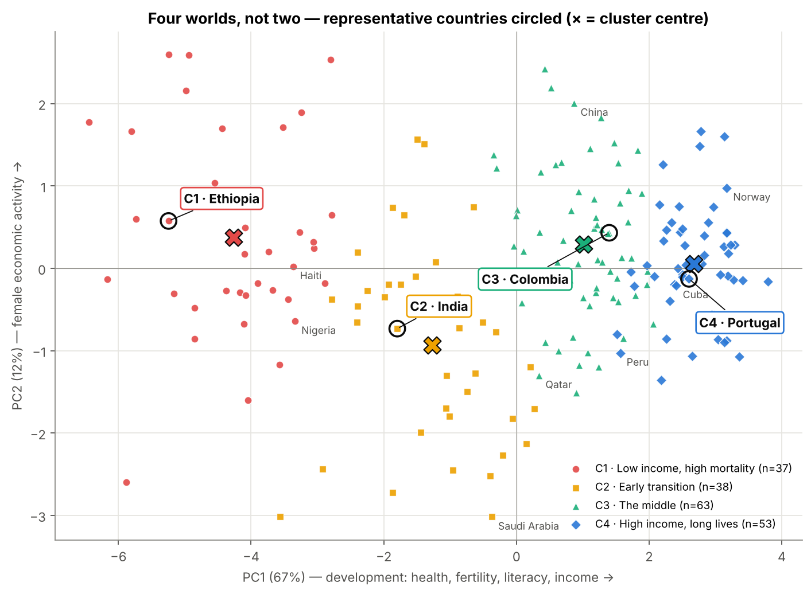
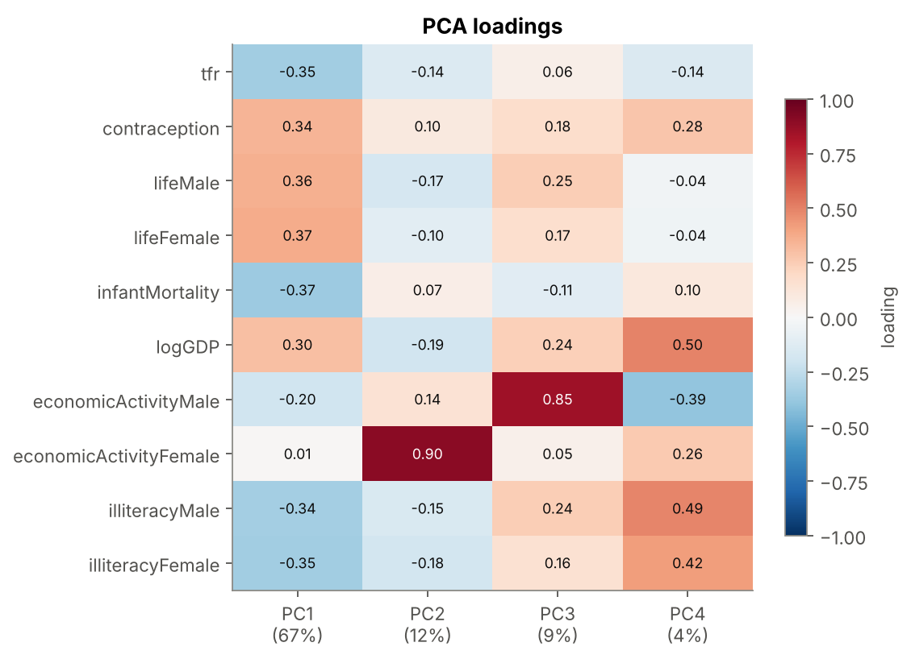
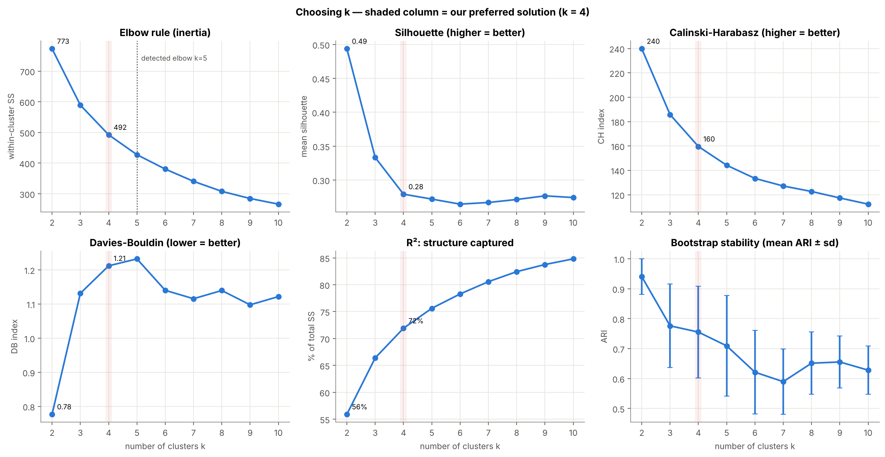
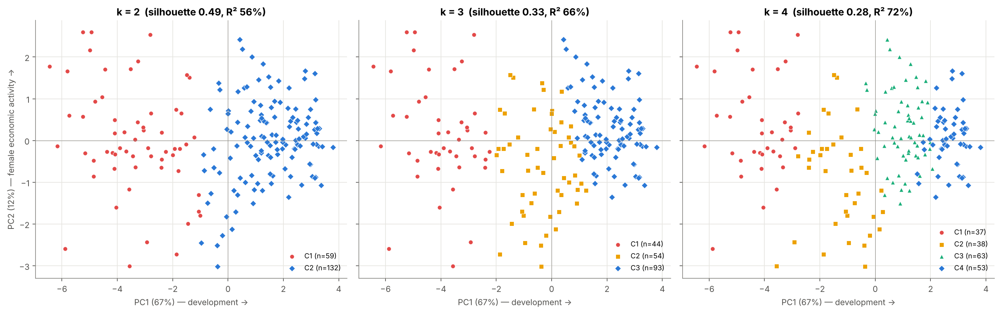
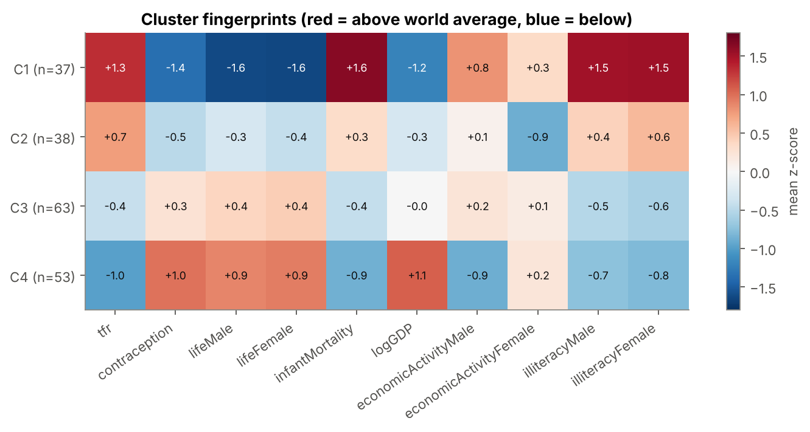

# How Many Worlds? PCA + K-Means on UN Country Data

**Research question:** Can the world be meaningfully divided into only two groups (developed vs. developing countries), or does the data suggest a more complex structure?

**Short answer:** No. A two-group split exists statistically, but it only separates a high-mortality "tail" from everyone else, putting Switzerland and Tajikistan in the same group. The countries form a **continuum** along one development axis, and **four clusters** describe it much better. Those four clusters line up with the four levels in Hans Rosling's *Factfulness*.

## Repository contents

| File | What it is |
|---|---|
| `un_clusters_analysis.ipynb` | Complete analysis (Parts 1–4 + answers), executed, with all outputs and interpretation |
| `UN.csv` | Dataset ([source](https://raw.githubusercontent.com/manoelgadi/PSDMA/refs/heads/main/datasets/UN.csv)) |
| `figures/` | All 14 charts produced by the notebook |
| `PRESENTATION.md` | 2–3 minute talk script |
| `requirements.txt` | Python packages |

**Reproduce:** `pip install -r requirements.txt`, then run all cells of the notebook. All random steps use fixed seeds.

> **Note on the data:** the UN indicators date from the late 1990s (the `UN` dataset in John Fox's *car* R package), so country positions describe that period, not today.

## How this combines our group's work

Three of us analysed the data independently. All three drafts agreed on the main conclusion: k = 2 has the best silhouette but is not meaningful, and k = 4 is the better description. The drafts differed in how they prepared the data. This final version keeps the strongest part of each draft and resolves the conflicts:

| Element | From | Why |
|---|---|---|
| Test of whether values are missing at random (Mann-Whitney), regression imputation | Draft B | Missingness follows development, so a single median fill is biased |
| Bartlett / KMO, Mahalanobis outliers, variable contributions, ARI by number of PCs, bootstrap stability | Draft B | Formal evidence that PCA is appropriate and useful |
| Log of GDP only, Ward dendrogram, silhouette profiles, cluster fingerprints, R² comparison | Draft C | Keeps clusters ordered by development level; cross-checks with Session 7 methods |
| Factfulness level names and lifestyle descriptions, full country lists, median-GDP chart | Draft A | Links the clusters to the book; membership is easy to check |

**Two corrections came out of comparing the drafts:**
- **Draft A kept countries with almost no data.** It filled every gap with the global median, so Monaco, San Marino and Liechtenstein landed in the rich cluster on imputed values alone. We drop the 16 countries missing more than 4 of the 10 variables.
- **Draft B also log-transformed illiteracy.** That stretches 0.3% vs 3% as much as 3% vs 30%. Combined with near-zero values reported by ex-Soviet countries, it created a "near-zero illiteracy" cluster that is poorer than the cluster ranked below it. We keep illiteracy unlogged and report the logged version as a robustness check (Part 3.6).

---

## Part 1: Data preparation

| # | Decision | Why |
|---|---|---|
| 1 | Drop `educationMale` / `educationFemale` | 63% missing; schooling is largely captured by illiteracy |
| 2 | Drop 16 countries missing more than 4 of 10 variables | Their profile would be mostly imputed (micro-states such as Andorra and Monaco; disrupted territories such as Somalia and Gaza Strip) |
| 3 | Regression imputation (`IterativeImputer`) for the remaining 9.9% of cells | Illiteracy is missing mostly for **rich** countries and economic activity mostly for **poor** ones (Mann-Whitney p < 0.001). A global median would give rich countries 20% female illiteracy; regression gives 8.8% |
| 4 | `log10(GDPperCapita)` only; keep all outliers | GDP skewness drops from 2.0 to 0.0. Other extreme values are real, and the only multivariate outlier (Maldives) barely affects results |
| 5 | Standardise all variables (z-scores) | Without scaling, PCA is 100% GDP (raw) or dominated by infant mortality (after logging GDP). These are artefacts of units, not patterns |

**Final matrix:** 191 countries × 10 variables.

## Part 2: PCA

Bartlett's test p ≈ 0 and KMO = 0.86, so the data are well suited to PCA.

| PC | % variance | Cumulative | Main variables |
|---|---|---|---|
| PC1 | 67.1% | 67.1% | life expectancy, infant mortality, illiteracy, fertility, contraception, log GDP (all similar weight) |
| PC2 | 11.6% | 78.7% | female economic activity (81.5% of PC2) |
| PC3 | 8.7% | 87.4% | male economic activity |
| PC4 | 4.4% | **91.8%** | mixed (income, literacy, contraception) |

**4 components explain 90%+ of the variance.** Clustering on them gives almost the same groups as clustering on all 10 variables (ARI 0.90).

## Part 3: How many clusters?

| k | R² (between-SS / total) | Silhouette | Bootstrap stability (ARI) |
|---|---|---|---|
| **2** | 56% | **0.49** | 0.94 |
| 3 | 66% | 0.33 | 0.78 |
| **4** | **72%** | 0.28 | 0.76 |
| 5 | 76% | 0.27 | 0.71 |
| 6 | 78% | 0.26 | 0.62 |

**Robustness of k = 4** (ARI against the main solution):

| Alternative | ARI |
|---|---|
| No PCA (all 10 variables) | 0.90 |
| Region-median imputation | 0.80 |
| Global-median imputation | 0.89 |
| Without the outlier | 0.98 |
| Ward hierarchical clustering | 0.67 |
| Log of illiteracy and infant mortality | 0.46 |

The two extremes are stable across all of these. The boundaries in the middle are soft.

## Part 4: The four clusters

| Cluster | n | Representative | Fertility | Infant mortality | Female life exp. | Female illiteracy | Median GDP/cap |
|---|---|---|---|---|---|---|---|
| C1 · Level 1: low income, high mortality | 37 | **Ethiopia** | 5.8 | 103 | 52 | 70% | \$293 |
| C2 · Level 2: early transition | 38 | **India** | 4.8 | 56 | 63 | 40% | \$1,156 |
| C3 · Level 3: the middle | 63 | **Colombia** | 2.8 | 23 | 74 | 8% | \$1,860 |
| C4 · Level 4: high income, long lives | 53 | **Portugal** | 1.7 | 7 | 80 | 5% | \$14,111 |

Each representative is among the 5 countries closest to its cluster centre and has no imputed values.

---

## Answers to the six questions

### 1. Can the world be meaningfully divided into only two clusters?
**Statistically yes, meaningfully no.** The two-cluster solution is the best separated (silhouette 0.49), but it is a lopsided split of 59 vs. 132 countries:
- **Cluster 1** holds high-fertility, high-mortality countries: mostly sub-Saharan Africa plus Afghanistan, Pakistan, India and Bangladesh.
- **Cluster 2**, the "developed" group, contains everyone else. Its GDP per capita ranges from **\$122 (Tajikistan) to \$42,416 (Switzerland)**, a 350× range. Infant mortality ranges from 2 to 78 per 1,000 and fertility from 1.2 to 7.2.

It captures only **56%** of the data's structure. It separates a tail, not two worlds.

### 2. How many clusters does the data suggest?
- **Elbow rule:** a gradual bend in the **k = 4–5** region. The objective detector picks 5, with 4 virtually tied.
- **Silhouette, Calinski-Harabasz and Davies-Bouldin:** all favour **k = 2**. They reward the single widest gap in what is otherwise a continuum.
- **R²:** gains shrink after k = 4.
- **Bootstrap stability:** acceptable up to k = 4 (0.76), then falls.

Weighing all the evidence, we choose **k = 4**; k = 3 and 5 are also defensible. A Ward dendrogram tells the same story: one big first cut, then no clear second gap.

### 3. How much structure do two clusters capture compared with four?
- **k = 2:** 56% of the total variance (between-cluster share in the 4-PC space).
- **k = 4:** 72%, which is 16 percentage points more.

The remaining 28% sits *within* clusters, further evidence of a continuum.

### 4. Does the evidence support *Factfulness*?
**Largely yes.**
- The PCA map shows a continuum with most countries in the middle, not two blobs.
- The four clusters are ordered along the development axis, and their profiles match Rosling's four levels: from no shoes and water fetched on foot, to bicycles, to motorbikes and running water, to cars.
- Our 1990s GDP figures are not in Rosling's purchasing-power dollars, so the match is in ordering, not exact thresholds.

Two caveats:
- On a continuum, the exact boundaries depend on the method.
- Silhouette alone would pick two groups.

Both caveats support Rosling's deeper point: there is no gap separating "us" from "them", only a gradient that several levels describe better than two.

### 5. What does PCA tell us about the variables that differentiate countries?
- **One dimension dominates.** PC1 explains 67% of the variance. Life expectancy, infant mortality, fertility, contraception, illiteracy and income all load on it with similar weight, so development is a *bundle*. Health and demography separate countries more than GDP does: log GDP contributes 9% to PC1, against 13–14% each for female life expectancy and infant mortality.
- **The second dimension is women's economic activity** (PC2, 12%). It separates countries at the *same* development level. For example, Saudi Arabia (7% female participation) and China sit far apart on PC2 although both are mid-development.
- **Four PCs keep 92% of the information**, so PCA removes redundancy before clustering.

### 6. How would you describe the clusters, using one representative country each?

**C1, Ethiopia (Level 1): high fertility, high mortality, extreme poverty.**
- *Profile:* 7 children per woman, 4% contraceptive use, infant mortality of 107, life expectancy of 48/52, three in four women illiterate.
- *Members:* mostly sub-Saharan Africa.
- *Surprise:* Haiti, Afghanistan, Nepal and Bangladesh are here too. Afghanistan has the cluster's highest reported GDP (\$2,848) and is the member farthest from the centre, so income did not translate into health.

**C2, India (Level 2): early transition, with few women in paid work.**
- *Profile:* India is the 2nd most typical member. Fertility is falling (3.1) and life expectancy is about 62, but infant mortality is still 72, female illiteracy is 62% and female economic activity is 34%.
- *Members:* Pakistan, Egypt, Morocco, Iran, Kenya, Ghana, Bolivia.
- *What sets it apart:* the lowest female labour participation of any cluster.
- *Surprises:*
  - **Saudi Arabia, Oman and Libya** are here despite much higher incomes, because their fertility and female indicators match.
  - **Botswana, Namibia and Zimbabwe** are here because AIDS lowered their life expectancy.

**C3, Colombia (Level 3): the big middle.**
- *Profile:* Colombia is within a few percent of the cluster median on most variables. Fertility is 2.7, contraception 72%, infant mortality 24 and GDP \$2,215.
- *Members:* the largest and most diverse cluster. It includes Latin America, China, Indonesia, Thailand, Viet Nam and the former USSR.
- *Surprises:*
  - It spans Tajikistan (\$122) to New Caledonia (\$19,450).
  - The **UAE and Qatar** have incomes like Europe's but health and demography like Colombia's.
  - **Russia** is here because of high 1990s adult mortality.

**C4, Portugal (Level 4): low fertility, long lives, high income.**
- *Profile:* fertility 1.5, infant mortality 8, female life expectancy 79. Its illiteracy (13% female) is a legacy of older generations' schooling.
- *Members:* Western and Central Europe, North America, Japan, Australia.
- *Surprises:*
  - **Cuba** (about \$2,000 GDP), **Bulgaria**, **Suriname** and **Uruguay** share the cluster with Switzerland because their health and fertility match the rich world.
  - **Peru** is the member farthest from the centre, a boundary case.

Clusters describe *how people live*, not only how much they earn.
